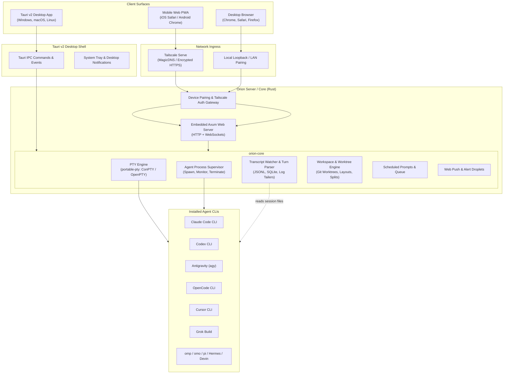

# Orion: Master Architecture & Reconstruction Plan

> **Product Definition:** Orion is an open-source, local-first AI agent orchestrator and multi-device control panel. It runs on your computer (desktop app via Tauri v2 or headless daemon) and allows you to monitor, guide, approve, and command terminal AI coding agents (Claude Code, Codex, Antigravity, OpenCode, Cursor CLI, Grok, omp, omo, pi, Hermes, Devin) from desktop or mobile (installable PWA over Tailscale/LAN).
>
> **Core Architectural Evolution:** Orion replaces external multiplexer dependencies (herdr daemon) with an embedded, native Rust core (`orion-core`) that directly owns PTY allocation, process supervision, transcript parsing, and remote streaming.

---

## 1. Executive Summary & Thesis

### 1.1 The Problem with the Herdr / Orbit Architecture
Orbit achieved exceptional companion ergonomics (phone-first chat turns, interactive prompt cards, live xterm.js parity, Tailscale pairing) but was fundamentally limited by its architecture:
1. **External Process Coupling:** Orbit was merely a bridge to the `herdr` multiplexer daemon over a Unix domain socket. If herdr crashed, stalled, or desynchronized, Orbit had no recourse.
2. **Runtime Impedance Mismatch:** Bun panics when loading `node-pty`. This forced Orbit into a complex multi-process split (Bun backend + Node PTY sidecar on POSIX; screen-mirroring polling on Windows).
3. **Platform Inequity:** On Windows, terminal attach was unsupported in herdr, requiring slow, fixed-grid screen scraping instead of raw PTY streaming.
4. **Single-RPC Socket Fragility:** Herdr closed its socket after every single RPC response, adding connection churn and requiring an open event subscription loop.

### 1.2 The Orion Solution
Orion is reconstructed as a **self-contained, unified system**:
1. **Native Rust Engine (`orion-core`):** Direct process management and PTY control using `portable-pty` (ConPTY on Windows, OpenPTY on Linux/macOS). No Node sidecar. No Bun panics. Full native performance across Windows, macOS, and Linux.
2. **Dual-Form Delivery via Tauri v2:**
   - **Desktop Application:** Native OS window (via Tauri v2 with system webview) hosting the React 19 UI with ultra-low resource overhead.
   - **Headless / Background Service (`orion serve`):** Can run on headless servers, Linux cloud devboxes, or background workstations, serving the exact same responsive UI over Tailscale or LAN as a PWA.
3. **Bring-Your-Own-Subscription Orchestration:** Users bring their existing CLIs (`claude`, `codex`, `opencode`, `cursor`, etc.) and authenticated plans. Orion coordinates parallel execution across isolated git worktrees, captures structured transcripts, and exposes approval cards.
4. **Zero-Telemetry, Local-First Privacy:** Data never touches third-party relays. Audio transcription runs locally or direct to OpenAI using the user's private key. Network connections remain strictly on the user's local network or Tailscale tailnet.

---

## 2. Competitive Positioning & Inspiration

| Dimension | Orion | T3 Code | Paseo | Orbit (Legacy) | Zed Agent Panel |
| :--- | :--- | :--- | :--- | :--- | :--- |
| **Primary Architecture** | Tauri v2 + Rust Core + React 19 | Electron + Vite + Local Server | Custom Daemon + Expo Mobile / Electron | herdr plugin (Bun + Node) | Native Rust Editor (GPUI) |
| **Multiplexer Dependency** | **None** (Embedded PTY Engine) | None (Wraps agent CLIs) | None (Self-hosted daemon) | **Strict dependency on herdr** | None (Editor-native) |
| **Desktop App** | Native Tauri v2 (Win / Mac / Linux) | Electron | Electron / Native macOS | Web PWA only | Native macOS / Linux / Win preview |
| **Mobile Access** | Installable PWA with Touch Key Bar | Native App (iOS / Android) | Native App (iOS / Android) | Installable PWA | None |
| **Remote Gateway** | Built-in Tailscale Serve + LAN Auth | Local server | Hosted or direct E2EE relay | Tailscale Serve / SSH via herdr | None (Desktop only) |
| **Agent Support** | Claude, Codex, Agy, OpenCode, Cursor, Grok, omp, omo, pi | Claude, Codex, Cursor, Grok, OpenCode, Agy, fx | Claude, Codex, Copilot, OpenCode, Pi, Agy | Claude, Codex, omp, omo, pi, OpenCode, Grok, Agy | Claude, Codex, Gemini, OpenCode via ACP |
| **Terminal View** | Raw xterm.js live PTY toggle | Embedded web terminal | Embedded terminal tabs | xterm.js live pane | Native terminal tabs |
| **License & Freedom** | MIT | MIT (very early, closed PRs) | Apache-2.0 | MIT | GPL-3.0 / Apache-2.0 |

---

## 3. High-Level System Architecture



---

## 4. Subsystem Specifications

### 4.1 Subsystem A: The Native Rust PTY Engine (`orion-pty`)
* **Role:** Allocate pseudo-terminals, handle bidirectional stdin/stdout streaming, synchronize window dimensions (rows/columns), and manage process signal delivery.
* **Implementation:** `portable-pty` crate.
  * Windows: Uses modern Windows Pseudo Console (ConPTY) via `CreatePseudoConsole`. No screen scraping.
  * Unix: POSIX `openpty`.
* **Streaming Protocol:** Raw binary or framed text over WebSockets / Tauri IPC events.
* **Flow Control:** Buffer limits to prevent browser memory exhaustion on infinite log dumps; pause/resume signal propagation.

### 4.2 Subsystem B: Agent Process Supervisor (`orion-agent`)
* **Role:** Spawn, monitor, track process trees, and cleanly terminate AI agent processes.
* **Capabilities:**
  * Auto-detect agent CLIs on system PATH (`claude`, `codex`, `opencode`, `cursor`, `grok`, `omp`, `pi`, `devin`).
  * Support custom environment variable injection per session (`ANTHROPIC_API_KEY`, `OPENAI_API_KEY`, `XDG_CONFIG_HOME`, etc.).
  * Clean tree termination: On Windows, use Job Objects; on Unix, use process group signals (`SIGTERM` -> timeout -> `SIGKILL`).
  * Process status machine: `Idle` -> `Spawning` -> `Running` -> `NeedsInput` -> `Done` -> `Exited(code)`.

### 4.3 Subsystem C: Transcript Introspection & Turn Parser (`orion-transcript`)
* **Role:** Parse native agent history files into structured conversation turns rather than forcing the user to read raw terminal scrollback.
* **Parsers:**
  * **Claude Code:** Tailing `~/.claude/projects/<project-hash>/sessions/<session-id>.jsonl`. Parse `tool_use`, `TodoWrite`, `TaskCreate`, diff edits, user prompts, assistant text.
  * **Codex CLI:** Reading rollout files and SQLite history DBs. Extract commentary, tool execution, and approval requests.
  * **OpenCode:** Direct SQLite integration with OpenCode 2 database (`opencode.db`).
  * **omp / omo:** Native JSONL session records with subagent task trees.
  * **Fallback:** Live terminal text capture with soft-wrapping preservation when no structured parser matches.

### 4.4 Subsystem D: Interactive Approval & Prompt Interceptor
* **Role:** Detect when an agent is waiting for user action and elevate it to a first-class card:
  * **Tool Execution Approvals:** "Allow `git push origin main`? [Yes] [No] [Always]"
  * **Multi-Choice Questions:** Agent asks for clarification; options rendered as clickable radio/pill buttons.
  * **Model Switching:** List available models dynamically from provider config.
  * **Plan Tasklists:** Render active agent todos with phase breakdowns, completed checkmarks, and elapsed timers.
  * **Safety Checks:** Ensure prompts are validated as still current before dispatching answers to avoid race conditions.

### 4.5 Subsystem E: Workspaces, Layouts & Git Worktrees
* **Role:** Multi-tenant workspace management allowing multiple concurrent agents to work on the same or different repositories.
* **Capabilities:**
  * Workspace tabs, horizontal/vertical splits, zoomed pane view.
  * One-tap git worktree creation (`worktree/feature-xyz`) so parallel agents never collide on uncommitted files.
  * Automatic worktree cleanup when task is finished or discarded.
  * Integrated Git diff inspector (Unified & Split) with syntax highlighting.

### 4.6 Subsystem F: Remote Gateway, Tailscale & PWA Companion
* **Role:** Deliver the exact Orbit mobile experience without requiring herdr.
* **Implementation:**
  * Embedded Axum HTTP + WebSocket server listening on `127.0.0.1:7317` (configurable).
  * Auto-detect `tailscale`: Invoke `tailscale serve --https=...` to generate secure MagicDNS ingress and QR code.
  * Local device pairing: 6-digit numeric pairing code or cryptographically secure token stored in `devices.json`.
  * Web Push: VAPID key generation and delivery to iOS Safari (iOS 16.4+) and Android Chrome.
  * Voice Dictation: Direct OpenAI Whisper API transcription (using user's stored key) or browser `webkitSpeechRecognition`.

### 4.7 Subsystem G: Frontend UI & Quiet Slate Design
* **Role:** Beautiful, dense, dark/light UI optimized for mobile touch and desktop productivity.
* **Stack:** React 19, TypeScript, Tailwind CSS v4, `@xterm/xterm`, Lucide icons, KaTeX (math), Mermaid (diagrams).
* **Key Features:**
  * Mobile touch key bar (Esc, Tab, Ctrl, Alt, Shift, arrows, custom macros).
  * Chat/Terminal toggle with instant zero-loss state retention.
  * Message composer with `@` file mentions, `/` slash commands, and image/camera uploads.
  * "Send Later" prompt scheduler holding input until the agent completes its active turn.

---

## 5. Directory Structure

```
C:\rust-projects\orion\
├── .cargo/
│   └── config.toml                  # Cross-platform compilation flags
├── Cargo.toml                       # Root Cargo workspace manifest
├── package.json                     # Frontend scripts & dependencies
├── tsconfig.json                    # Frontend TypeScript config
├── vite.config.ts                   # Vite bundler config for Tauri v2 & Web
├── tailwind.config.ts               # Tailwind CSS v4 design tokens
├── PLAN.md                          # Master implementation plan (this document)
├── AGENTS.md                        # Project conventions, invariants, and traps
├── README.md                        # Project introduction, quickstart & docs
├── crates/
│   └── orion-core/                  # Core Rust engine (daemon & Tauri shared)
│       ├── Cargo.toml
│       └── src/
│           ├── lib.rs               # Library entry point
│           ├── error.rs             # Unified error types
│           ├── pty/                 # Cross-platform PTY abstraction
│           │   ├── mod.rs
│           │   ├── portable.rs      # portable-pty integration
│           │   └── stream.rs        # Async channel & buffer manager
│           ├── agents/              # Agent adapters & process lifecycle
│           │   ├── mod.rs
│           │   ├── registry.rs      # Discovery of claude, codex, etc.
│           │   ├── process.rs       # Process spawning & signal control
│           │   └── adapters/        # Individual CLI flag/env handlers
│           ├── transcript/          # Session file parsing
│           │   ├── mod.rs
│           │   ├── claude.rs        # Claude Code JSONL tailer
│           │   ├── codex.rs         # Codex rollout / SQLite reader
│           │   └── opencode.rs      # OpenCode SQLite reader
│           ├── workspace/           # Layout, sessions & git worktrees
│           │   ├── mod.rs
│           │   ├── layout.rs        # Workspaces, tabs, splits
│           │   └── worktree.rs      # Git worktree CLI invocations
│           ├── server/              # Axum HTTP + WebSocket remote gateway
│           │   ├── mod.rs
│           │   ├── routes.rs        # REST API endpoints
│           │   ├── ws.rs            # Terminal & event WebSockets
│           │   ├── auth.rs          # Device tokens & pairing codes
│           │   └── tailscale.rs     # Tailscale Serve process integration
│           └── push/                # Web Push notification dispatcher
│               └── mod.rs
├── src-tauri/                       # Tauri v2 Desktop Shell
│   ├── Cargo.toml
│   ├── tauri.conf.json              # Tauri v2 configuration
│   ├── capabilities/
│   │   └── default.json             # Tauri permissions
│   └── src/
│       ├── main.rs                  # Desktop app entrypoint
│       ├── lib.rs                   # App initialization & plugin setup
│       └── commands/                # Tauri IPC command handlers
│           ├── mod.rs
│           ├── pty.rs
│           ├── agents.rs
│           ├── workspace.rs
│           └── remote.rs
└── src/                             # Frontend application (React 19 + TypeScript)
    ├── index.html
    ├── main.tsx                     # React root mounting
    ├── App.tsx                      # Main application shell
    ├── styles/                      # Quiet Slate CSS tokens & base styles
    │   ├── theme.css
    │   └── globals.css
    ├── components/
    │   ├── chat/                    # Conversational agent views
    │   │   ├── ConversationView.tsx
    │   │   ├── MessageTurn.tsx
    │   │   ├── ApprovalCard.tsx
    │   │   ├── PlanTasklist.tsx
    │   │   └── Composer.tsx
    │   ├── terminal/                # Live xterm.js terminal integration
    │   │   ├── TerminalView.tsx
    │   │   ├── TouchKeyBar.tsx
    │   │   └── TerminalSearch.tsx
    │   ├── sidebar/                 # Workspaces, agents & status dots
    │   │   ├── Sidebar.tsx
    │   │   └── WorkspaceList.tsx
    │   ├── viewer/                  # File & diff inspector
    │   │   ├── FileViewer.tsx
    │   │   └── DiffViewer.tsx
    │   └── modals/                  # Settings, pairing, voice, new agent
    │       ├── NewAgentModal.tsx
    │       ├── PhonePairingModal.tsx
    │       └── SettingsModal.tsx
    ├── hooks/                       # Custom React hooks
    │   ├── useOrionClient.ts        # Unified client (Tauri IPC or WebSocket)
    │   ├── usePtyStream.ts          # Terminal streaming hook
    │   └── useVoiceInput.ts         # Voice recording & transcription
    └── types/
        ├── protocol.ts              # Wire protocol types (Rust-mirrored)
        └── agent.ts                 # Agent status & transcript models
```

---

## 6. Detailed Implementation Phases

### Phase 0: Scaffolding & Core Foundations
* [x] Initialize Git repository in `C:\rust-projects\orion`.
* [ ] Write root `Cargo.toml` and workspace definitions.
* [ ] Create `crates/orion-core` crate with domain models, error handling, and type declarations.
* [ ] Configure Tauri v2 in `src-tauri` (`tauri.conf.json`, permissions, build script).
* [ ] Scaffold React 19 + TypeScript + Vite + Tailwind CSS v4 in root.
* [ ] Establish mirrored wire protocol types in Rust (`serde`) and TypeScript.

### Phase 1: Native PTY & Agent Process Supervisor
* [ ] Implement `orion_core::pty::PtySession` using `portable-pty`.
* [ ] Implement Windows ConPTY and POSIX OpenPTY adapters.
* [ ] Implement bidirectional async channel streaming (tokio mpsc).
* [ ] Implement Agent Discovery: scan PATH for `claude`, `codex`, `opencode`, `cursor`, `grok`, etc.
* [ ] Implement Process Supervisor: launch agent in dedicated PTY, configure environment, attach lifecycle monitoring, handle clean shutdown.
* [ ] Verify PTY terminal streaming with raw bash / powershell / cmd.

### Phase 2: Transcript Parsers & Live Card Interceptor
* [ ] Implement Claude Code JSONL watcher: tail live session file, parse turns, extract tool executions, code diffs, and todo plans.
* [ ] Implement Codex transcript watcher: extract approvals and commentary.
* [ ] Implement interactive prompt card extraction (detect permission asks and choices).
* [ ] Create IPC / WebSocket message envelope for real-time turn streaming.
* [ ] Add fallback stream reader for agents without native transcript stores.

### Phase 3: Tauri v2 Desktop App & Terminal UI
* [ ] Integrate `@xterm/xterm` with `@xterm/addon-fit`, `@xterm/addon-web-links`, and `@xterm/addon-unicode-graphemes`.
* [ ] Implement dual-view toggle: Chat view (structured turns) <-> Terminal view (raw xterm).
* [ ] Build responsive chat composer with `@` file auto-complete, `/` commands, and draft preservation.
* [ ] Implement approval cards with one-click responses (Allow, Deny, Option selection).
* [ ] Implement Quiet Slate color palette and light/dark theme switcher.

### Phase 4: Workspaces, Splits & Git Worktrees
* [ ] Implement multi-pane workspace layout (sidebar with live RUN/INPUT/DONE indicators).
* [ ] Add split-pane support (horizontal and vertical terminal/chat splits).
* [ ] Implement Git worktree manager:
  * `git worktree add <path> <branch>`
  * Launch target agent inside newly created worktree
  * Automatic diff calculation against parent branch
  * Safe cleanup on task completion.

### Phase 5: Remote Web Gateway, Tailscale & PWA Companion
* [ ] Build embedded Axum server inside `orion-core`.
* [ ] Implement HTTP REST API and WebSocket connection endpoint matching desktop IPC.
* [ ] Implement `tailscale` CLI bridge: detect Tailscale, invoke `tailscale serve`, generate MagicDNS URL and QR code.
* [ ] Implement pairing security: 6-digit PIN, device token store (`devices.json`), timing-safe authentication headers.
* [ ] Build Mobile Touch Key Bar (Esc, Tab, Ctrl, Alt, Shift, arrows, customizable buttons).
* [ ] Verify PWA installation on iOS Safari and Android Chrome over Tailscale HTTPS.

### Phase 6: Proactive Alerts, Push Notifications & Voice
* [ ] Implement Web Push notifications using VAPID keys for remote phone alerting.
* [ ] Implement in-app droplet alert banner for background agent events.
* [ ] Add voice dictation engine:
  * Browser Web Speech API fallback.
  * Direct OpenAI Whisper API integration with local key storage.
* [ ] Add "Send Later" prompt scheduler to prevent interrupting active turns.

### Phase 7: Polish, Verification & Standalone Binary Packaging
* [ ] Build CLI entrypoint `orion serve` for headless Linux / macOS servers.
* [ ] Package Tauri v2 desktop bundles (Windows MSI/NSIS, macOS DMG, Linux AppImage/deb).
* [ ] Comprehensive automated tests:
  * Rust unit and integration tests (`cargo test`).
  * Frontend unit tests (`bun test`).
  * End-to-end PTY streaming and reconnect tests.
* [ ] User documentation, migration guide from Orbit, and release automation.

---

## 7. Risk Analysis & Mitigations

| Risk | Impact | Mitigation Strategy |
| :--- | :--- | :--- |
| **ConPTY Resizing Glitches on Windows** | High | Use latest `portable-pty` with explicit ConPTY window size bounds; test with complex TUIs like lazygit and fzf. |
| **Agent Transcript Format Drift** | Medium | Isolate parsers behind generic `TranscriptAdapter` trait. If a parser fails or schema drifts, gracefully fallback to raw terminal scrollback without crashing. |
| **Orphaned Background Agent Processes** | Critical | Use Windows Job Objects (`kill_on_drop`) and POSIX process group signals to guarantee all spawned children exit when Orion exits. |
| **Mobile Web Audio / Mic Restrictions** | Medium | Require secure context (HTTPS via Tailscale MagicDNS or localhost). Provide clear onboarding when microphone permissions are denied. |
| **Memory Leak from High-Frequency Output** | High | Cap live terminal scrollback history (e.g., 5,000 lines); truncate oversized tool outputs in the chat view with "View full in Terminal" action. |

---

## 8. Definition of Done for Orion v1.0
1. Can launch, monitor, and approve Claude Code and Codex sessions simultaneously from both desktop and phone.
2. Zero external dependencies: no `herdr` installation required.
3. Native Tauri v2 app runs smoothly on Windows, macOS, and Linux.
4. Remote mode works over Tailscale with one-click QR code pairing on an iPhone or Android phone.
5. All tests pass with zero clippy warnings and complete TypeScript typecheck cleanliness.
