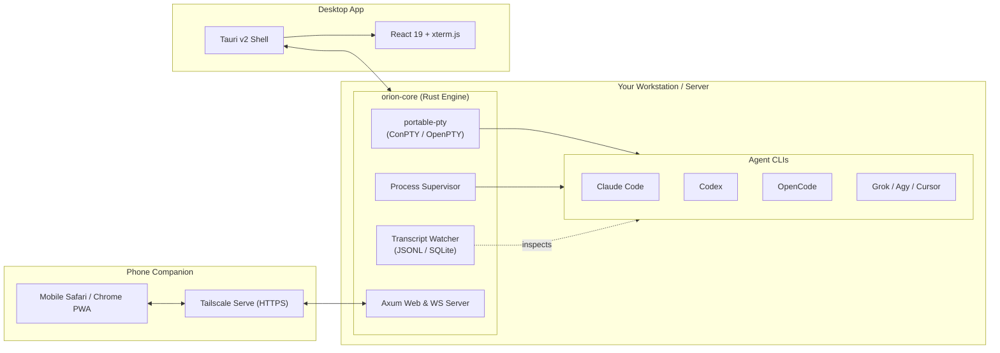

# Orion

<p align="center">
  <strong>Orchestrated Remote Integration &amp; Orchestration Node</strong><br>
  <em>The local-first AI agent orchestrator and multi-device control deck.</em>
</p>

<p align="center">
  <a href="LICENSE"></a>
  <a href="#desktop-app"></a>
  <a href="#supported-agents"></a>
  <a href="#mobile-remote"></a>
</p>

---

## What is Orion?

Orion is a standalone, local-first control center for autonomous and interactive AI coding agents. Run multiple agents in parallel across separate git worktrees, monitor their thoughts and tool executions as clean conversational chat turns, approve permissions with a tap from your phone, and instantly drop into live terminal sessions whenever you need low-level control.

Orion brings the best concepts of modern agent tooling together into an independent, high-performance architecture:
- **Zero Daemon Dependencies:** Does not depend on external terminal multiplexers. Orion natively allocates PTYs and supervises processes using Rust.
- **Tauri v2 Desktop App:** Lightweight native desktop application for macOS, Windows, and Linux.
- **Mobile Companion PWA:** Zero-install mobile client served over your private Tailscale tailnet (`tailscale serve`) or local Wi-Fi with instant QR code pairing.
- **Bring Your Own Subscriptions:** Works directly with the agent CLIs you already have authenticated (`claude`, `codex`, `opencode`, `cursor`, `grok`, etc.). No extra tokens or subscription markups.
- **Private & Telemetry-Free:** Your code, transcripts, and credentials never touch a remote SaaS server.

---

## Key Features

<table>
  <tr>
    <td width="50%" valign="top">
      <b>Dual-Lens: Chat Clarity &amp; Live Terminal</b><br>
      Reads native agent session records (Claude Code JSONL, Codex rollout, OpenCode SQLite) to render formatted Markdown, syntax-highlighted code, diffs, and math. One click toggles to the raw xterm.js PTY terminal.
    </td>
    <td width="50%" valign="top">
      <b>One-Tap Prompt Approvals</b><br>
      Elevates tool approval requests (`git push`, file edits, shell commands) and multi-choice questions into interactive cards you can answer with one thumb from your phone.
    </td>
  </tr>
  <tr>
    <td width="50%" valign="top">
      <b>Isolated Git Worktrees</b><br>
      Spawn multiple agents in parallel on the same repository without merge collisions. Each agent receives its own dedicated branch and working directory.
    </td>
    <td width="50%" valign="top">
      <b>Mobile Touch Key Bar</b><br>
      On touch devices, Orion renders a sticky modifier and shortcut bar (Esc, Tab, Ctrl, Alt, Shift, arrows, Enter, custom combos) so terminal interaction never fights the software keyboard.
    </td>
  </tr>
  <tr>
    <td width="50%" valign="top">
      <b>Tailscale Remote Pairing</b><br>
      Instant secure pairing via Tailscale Serve. Scan the desktop QR code with your phone to open your full dashboard anywhere—on the couch, commute, or walking.
    </td>
    <td width="50%" valign="top">
      <b>Hands-Free Voice Dictation</b><br>
      Dictate complex prompts and reviews into the composer using browser speech recognition or high-fidelity local/OpenAI Whisper transcription.
    </td>
  </tr>
</table>

---

## Architecture



---

## Supported Agents

Orion discovers and orchestrates any installed agent CLI on your `PATH`:

| Agent | Interface | Transcript Parsing | Prompt Approvals |
| :--- | :--- | :--- | :--- |
| **Claude Code** | Chat + Terminal | Native JSONL stream | Yes (Tool approvals, questions, plans) |
| **Codex CLI** | Chat + Terminal | Native rollout / DB | Yes (Command allow/deny, prompts) |
| **Antigravity (`agy`)** | Chat + Terminal | Native conversation lock | Yes (Confirmation cards) |
| **OpenCode** | Chat + Terminal | Native OpenCode 2 SQLite DB | Yes |
| **Cursor CLI** | Chat + Terminal | Native history index | Terminal interaction |
| **Grok Build** | Chat + Terminal | Update log stream | Terminal interaction |
| **omp / omo / pi** | Chat + Terminal | Native JSONL records | Yes (Dialogs, approvals) |
| **Hermes / Devin CLI** | Chat + Terminal | SQLite session store | Terminal interaction |
| **Standard Shell** | Live Terminal | Direct PTY stdout/stdin | Direct terminal keys |

---

## Quickstart

### 1. Prerequisites
- **Rust 1.80+** (installed via [rustup](https://rustup.rs))
- **Bun 1.2+** or **Node.js 20+**
- At least one authenticated agent CLI on your `PATH` (e.g. `claude`, `codex`, `opencode`)

### 2. Development Setup

Clone and install dependencies:
```bash
cd C:\rust-projects\orion
bun install
```

Run in Desktop mode (Tauri v2):
```bash
bun run tauri dev
```

Run in Headless Server mode (for remote devboxes or Tailscale):
```bash
cargo run --bin orion -- serve --port 7317
```

### 3. Connect from Mobile
1. Ensure [Tailscale](https://tailscale.com) is running on your host and phone.
2. Open the desktop app or run `orion pair`.
3. Scan the generated QR code with your phone camera.
4. Add the page to your Home Screen as an installable PWA.

---

## Project Structure

```
orion/
├── crates/orion-core/       # Core Rust engine: PTY, processes, transcripts, Axum
├── src-tauri/               # Tauri v2 desktop application wrapper
├── src/                     # React 19 UI: components, xterm.js, chat, diff viewer
├── PLAN.md                  # Comprehensive engineering roadmap & implementation plan
├── AGENTS.md                # System invariants, security rules, and contributor guidelines
└── package.json             # Frontend workspace dependencies and scripts
```

---

## License

[MIT](LICENSE) © 2026 Orion Contributors.
